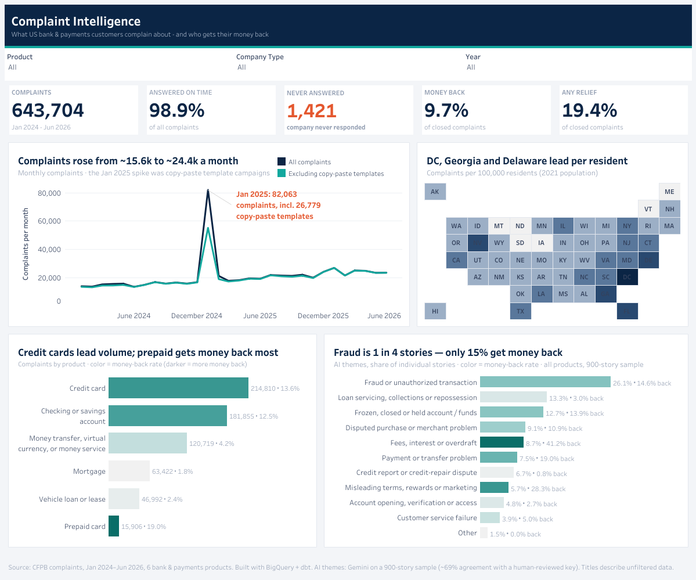
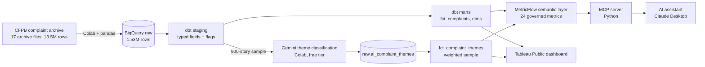
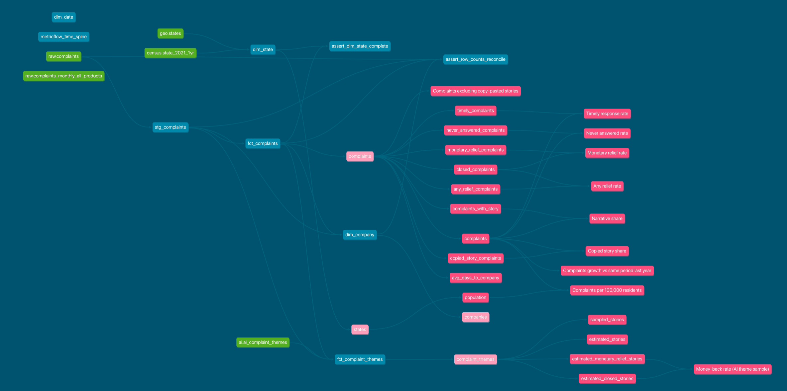

# Complaint Intelligence: AI-Ready Analytics for Financial Services

**What are US bank and payments customers complaining about, are companies handling it well, and can an AI assistant answer these questions reliably?**

An end-to-end analytics project on **643,704 CFPB consumer complaints** (Jan 2024 – Jun 2026): a tested dbt pipeline on BigQuery, a governed **semantic layer** (MetricFlow), **AI theme classification** of complaint stories (validated against a blind-reviewed human answer key), an **MCP server** that lets an AI assistant query the governed metrics, and a **Tableau Public** dashboard.

**[View the interactive dashboard on Tableau Public](https://public.tableau.com/app/profile/sandhiya3216/viz/ComplaintIntelligence-CFPBComplaints2024-2026/Dashboard1)** · [Executive memo](docs/executive_memo.md) · [Project brief](docs/project_brief.md) · [Data quality log](docs/data_quality_log.md) · [AI evaluation report](docs/ai_evaluation_report.md)



---

## The business problem

The stakeholder is the **Head of Customer Experience at a large US bank**, who wants an outside-in view of the market from public complaint data. They asked four questions:

| # | Question |
|---|---|
| Q1 | Are bank and payments complaints growing, and where? |
| Q2 | Are companies responding well, and is that getting better or worse? |
| Q3 | What are customers *actually* complaining about, beyond the CFPB's own categories? |
| Q4 | Can an AI assistant answer these questions reliably, and what makes it reliable? |

## Key findings

**Q1: Complaints are growing steadily, and the headline numbers hide it.**
- The monthly run rate rose from **~15,600 (2024) to ~20,800 (2025, excluding January) to ~24,400 (H1 2026)**.
- A naive comparison shows H1 2026 **down 18%**, but that's misleading. **January 2025 had 82,063 complaints**, inflated by **copy-paste template campaigns** that coincided with CFPB enforcement actions against Block (Cash App), Zelle's operator and Capital One. Excluding January, the run rate is **up 26%**.
- Fastest-growing (H1 2026 vs H1 2025): **mortgage +50%, vehicle loans +37%, credit card purchase disputes +90%**.
- **The top 15 companies receive 62% of complaints.** Per resident, DC, Georgia and Delaware lead. In 2025, complaints per 100k residents varied about 6x between states (DC 176 vs South Dakota 28, excluding templates).

**Q2: Response is fast, but outcomes are slipping.**
- **98.9%** of complaints are answered on time, but **"never answered" rose about 5x** (92 in Q2 2025 → 478 in Q2 2026).
- Only **9.7%** of closed complaints end with money back, and **any relief fell from ~26% (2024) to ~18% (2026)**.
- Within credit cards, money-back rates differ about 3x between large issuers with a similar complaint mix (**36% vs 11%**). That points to a real handling difference, not a product-mix effect.
- Copy-paste template complaints get money back **0.1%** of the time, vs **11.0%** for individually written stories.
- **48,472** complaints filed under bank products are actually about **credit bureaus**. These are flagged so bank-level metrics can exclude them.

**Q3: Fraud is the #1 problem, and the CFPB categories hide most of it.** (AI themes on a weighted sample of 900 stories)
- **Fraud or unauthorized transactions: ~26% of stories**, the #1 theme in checking, credit cards, prepaid and money transfer (**50%** of money-transfer stories).
- Only **about 1 in 5** of these stories was filed under a CFPB category that says "fraud" or "unauthorized". The rest sit in generic buckets like "Other transaction problem" or "Managing an account".
- Money back depends heavily on the problem: **fees 41%**, **fraud 15%**, **loan servicing 3%**, **credit report disputes 1%**.
- **Disputed purchases are rising** (6% → 9% → 16% of stories, 2024 → H1 2026). That matches the +90% growth in credit card purchase disputes found in Q1 with a completely different method.

**Q4: Governance lives in the modeling.**
- On a 20-question test, an AI assistant using the **governed metrics** answered **20/20** correctly; the same assistant writing its **own SQL** answered **19/20**.
- The AI-written SQL was accurate because it ran on **clean dbt marts** with pre-built flags (closed, copied story, credit bureau).
- The semantic layer's edge was **context and consistency**: the same definitions every time, plus the right caveat on the trickiest question (comparing a half-year of 2026 to a full 2025).

## Architecture



**dbt lineage** (sources → staging → marts → semantic models), generated with `dbt docs`:



## Tech stack

| Layer | Tools |
|---|---|
| Ingestion | Python (pandas) in Google Colab |
| Warehouse | Google BigQuery (free sandbox) |
| Transformation and testing | dbt Core 1.12 (staging view, mart tables, 25 data tests, lineage docs) |
| Semantic layer | dbt MetricFlow: 24 metrics (simple, ratio, derived year-over-year, filtered), validated against SQL |
| AI | Gemini 3.6 Flash (google-genai, structured output, temperature 0), free tier |
| AI integration | Model Context Protocol (MCP) server in Python, connected to Claude Desktop |
| BI | Tableau Public |
| Version control | Git + GitHub Desktop |

## Data and scope

- **Source:** [CFPB Consumer Complaint Database](https://www.consumerfinance.gov/data-research/consumer-complaints/), downloaded as monthly archive files.
- **Loaded:** 1,532,691 complaints across 10 non-credit-reporting products. Credit reporting (11.96M rows, about 89% of all complaints) is kept only as a monthly summary, to stay within free storage.
- **Analyzed:** **Jan 1, 2024 – Jun 30, 2026**, for 6 bank and payments products:
  - Credit card
  - Checking or savings account
  - Money transfer, virtual currency, or money service
  - Mortgage
  - Vehicle loan or lease
  - Prepaid card

  That's **643,704 complaints**, 346,734 of them with a written story.
- **Principle: flag, don't delete.** Out-of-period rows, out-of-scope products, copy-paste templates and credit bureau complaints are all **flagged** in staging, so every exclusion is visible and reversible.

### Data quality highlights
| Issue found | How it was handled |
|---|---|
| Written stories stop after mid-2026 | Analysis period ends Jun 30, 2026 |
| Jan 2025 spike (82,063 complaints) | Traced to template campaigns on specific dates (Jan 14–21, 2025) after CFPB enforcement news; `is_copied_story` flag; trends shown with and without copies |
| 37,908 copy-paste template stories (10.9% of in-scope stories) | Counted in volume, flagged, and excluded from AI sampling |
| "Untimely response" means never answered | Defined as **not closed**; relief rates use closed complaints as the denominator |
| Credit bureaus filed under bank products (48,472) | `is_credit_bureau` flag |
| State FIPS codes with leading zeros ("06" vs "6") dropped 7 states in the population join | Compared as integers; 51 states + DC, 331.9M people, reconciled by a dbt test |
| Company name spelling variants | `company_key = UPPER(TRIM(company))`, display name = most common spelling |

## AI theme classification (how it was validated)

1. **Human answer key:** 102 stories (17 per product) labeled by hand into 11 themes, **blind** (the CFPB issue and company hidden), using written [theme definitions](docs/theme_definitions.md).
2. **AI run 1:** 46.1% agreement.
3. **Blind review:** each disagreement was re-judged with the two labels shown in random order, without revealing which was the AI's. The AI was right in 23 of 45 cases, so the reviewed agreement was **68.6%**. The main issue was a vague "customer service" category.
4. **Dev/test split before prompt tuning:**
   - The improved prompt gained **+6 points on the dev half** but **nothing on the held-out test half (68.5%)**. That result is reported honestly.
   - The prompt did fix reliability: **0 missing answers, down from 10**.
5. **Big run:** 900 stories (150 per product), **weighted** back up to all 308,826 individual stories. It ran on the free tier: 30 requests over 3 days, with a request counter and stop-on-429 safety.

Full details are in the [AI evaluation report](docs/ai_evaluation_report.md).

## Semantic layer + MCP server

- **24 governed metrics** are defined once in YAML, for example:
  - `monetary_relief_rate` = money-back complaints ÷ **closed** complaints
  - `complaints_yoy_growth`, a derived metric with a 1-year offset
  - `complaints_per_100k_residents`, valid by state only
  - `theme_monetary_relief_rate`, from the weighted AI sample
- All metric results were checked against hand-written BigQuery SQL and matched exactly.
- [`mcp_server/complaints_server.py`](mcp_server/complaints_server.py) exposes 5 tools to an AI assistant:
  - `list_metrics`, `list_dimensions`, `query_metrics` (via MetricFlow)
  - `describe_tables`, `run_sql` (read-only, single SELECT, 200-row and 2 GB scan limits)
- The server also has **7 rules** for the assistant, such as "per-100k by state only", "never compare a half year to a full year", and "say so when the data can't answer".
- **20-question evaluation:** [questions](docs/mcp_test_questions.csv) · [results](docs/mcp_test_results.csv)

## Repository structure

```text
notebooks/       01 download & inspect · 02 load to BigQuery · 03 AI theme classification
sql/             01 data audit · 02–03 pipeline checks · 04–05 Exec Q1/Q2 · 06 AI sample · 07 Exec Q3
dbt/             models/staging · models/marts · models/semantic (metrics) · tests
mcp_server/      MCP server exposing the semantic layer to an AI assistant
data/            answer key, blind review, AI results, big-run labels, Tableau extracts
docs/            project brief · data quality log · theme definitions · AI evaluation report · executive memo · MCP test
images/          dbt lineage · dashboard
```

## How to reproduce

1. **Load the data:** run `notebooks/01` and `02` in Google Colab with a BigQuery project (the free sandbox works).
2. **Build:** in a Python 3.11 environment, run `pip install "dbt-metricflow[dbt-bigquery]"`, configure `~/.dbt/profiles.yml` (BigQuery, OAuth), then run `dbt build` in `dbt/`.
3. **Query the metrics:** for example, `mf query --metrics complaints,monetary_relief_rate --group-by complaint__product`.
4. **AI themes:** run `notebooks/03` in Colab with a Gemini API key stored in **Colab Secrets** as `GEMINI_API_KEY`. Never put keys in code.
5. **MCP:** `pip install "mcp[cli]"`, then add `mcp_server/complaints_server.py` to your MCP client's config.

## Limitations

- **This is complaint data, not a measure of wrongdoing.** Volume reflects customer base size and campaigns.
- **AI themes come from a 900-story sample** with about 69% agreement with a human reviewer. Small themes have wide margins, and **customer service is under-counted** by the AI.
- **Population is 2021** (the latest ACS 1-year data in BigQuery public data), while the complaints are from 2024–2026.
- **Written stories are only published with consumer consent** (about 54% of complaints).

## What I'd do next

- Re-run the MCP test against the **raw source table**, where I'd expect a much larger gap between governed metrics and AI-written SQL.
- Replace the "customer service" theme with a separate **yes/no service-failure flag** next to the main theme.
- Label a larger answer key (300+ stories) to narrow the accuracy margin, and track theme trends quarterly.
- Rebuild the dashboard on **Power BI / Microsoft Fabric**, reusing the same metric definitions.
